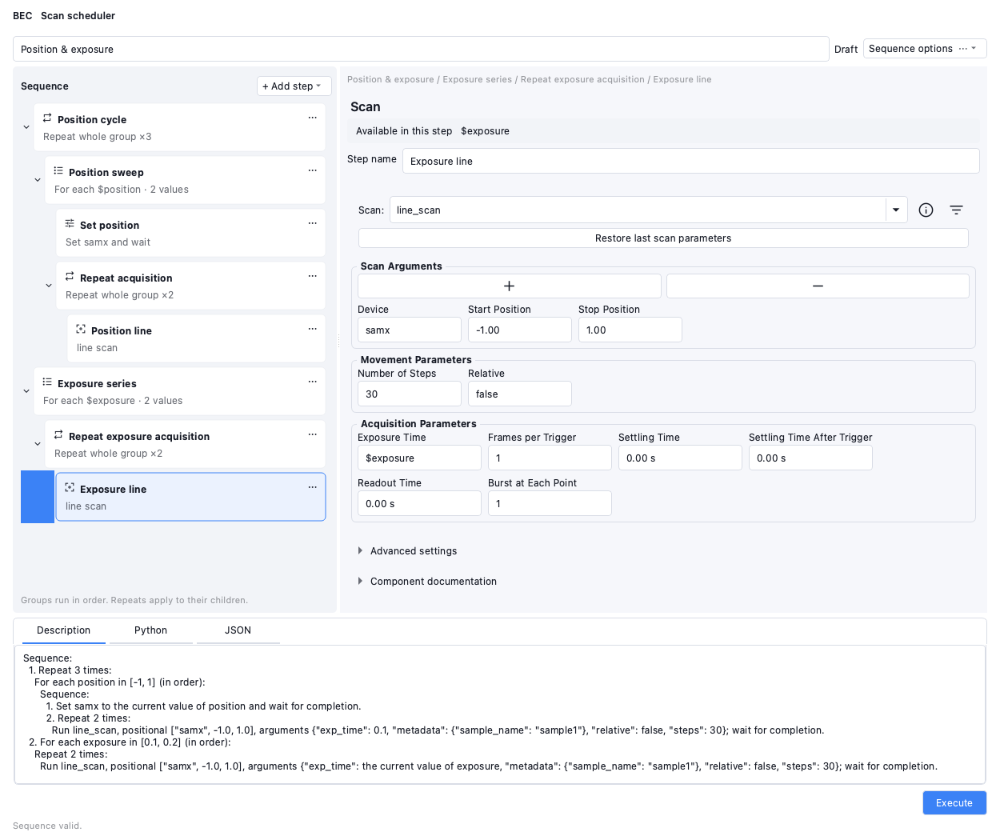

# Scan scheduler

The scheduler composes nested BEC sequence components and executes their JSON to the existing
`run_sequence` procedure. It requires the BEC `feature/scan_sequencer` branch, installed in both
this GUI environment and the procedure worker environment. There is no new execution service.

Open **Scan Scheduler** in `bec-app`, add a ScanScheduler through the GUI server/Designer, or run:

```bash
python -m bec_widgets.examples.scan_scheduler
```

Opening the example does not move hardware or acquire scans. Its `samx` and `time_scan` inputs
must be available on your deployment before validation/execution succeeds.

## Compose and inspect

- Select a sequence or loop, choose a component and click **Add step**. A selected sequence child
  inserts a sibling after that child. **Wrap** surrounds the selected step with a sequence or loop.
- Edit the selected component in the inspector. Changes save automatically. Repeat counts must
  be positive. The card menu provides wrap, reorder and remove actions.
- Set targets accept dotted device/signal names. **Wait for completion** controls native blocking
  set/move behavior. Visible for_each variables appear in the **Variable** selector.
- Scan definitions use the existing **ScanControl** widget: its scan selector, argument groups,
  device bundles, input bounds, units, tooltips and **Restore last** behavior. The scheduler hides
  its execution buttons; composing a step does not submit a scan. Inputs accept a visible loop variable directly, for example `$exposure`.
  Autocompletion offers the current scope; numeric literals retain their native bounds and units. Existing positional inputs remain positional, and untouched missing
  arguments remain missing so backend validation can reject them.
- **Advanced settings → Edit arguments as raw JSON** supports metadata, whole argument-mapping
  references and structured expressions. For example `{"ref": "pol"}`. Use
  `{"type": "literal", "value": ...}` to protect dictionaries resembling reserved expressions.
- **Description**, **Python** and **JSON** update automatically after editing. Description is
  selected first. Validation covers the complete tree, references and definitions. Execution also
  checks live scan/device inputs before requesting the procedure. Invalid sequences cannot execute.
- **JSON → Apply JSON** imports edits made to the document JSON. **Sequence options → Open/Save**
  uses standalone sequence documents. **Reusable definitions** accepts a JSON list of versioned
  backend definitions; save/share that list separately alongside a sequence that needs it.
  This prototype does not provide a reusable-definition authoring form.

## Execute

Choose **Execute** to validate the sequence and request the existing `run_sequence` procedure.
Validation and the request run off the Qt thread. The request contains the current JSON document
and the transitive reusable definitions it needs. The worker independently validates these inputs
before using native IPython scan/device calls. Scan implementations must be available in that worker.

The widget does not keep submission records, queue views or history. Procedure execution and
interruption remain owned by BEC. Closing this editor does not interrupt a running procedure.

## Programmatic use

```python
from bec_widgets.widgets.control.scan_scheduler import ScanScheduler

scheduler = ScanScheduler(client=bec)
scheduler.load_json(sequence_json, definitions_json)  # definitions defaults to "[]"
scheduler.show()
scheduler.validate_sequence()  # optional: refresh immediately instead of waiting for automatic updates
# scheduler.execute_sequence()  # explicit execution action
```


